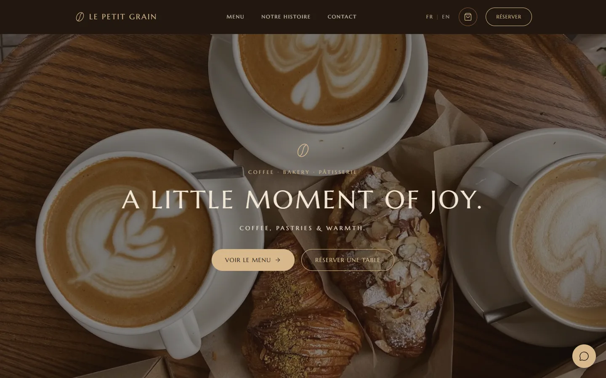
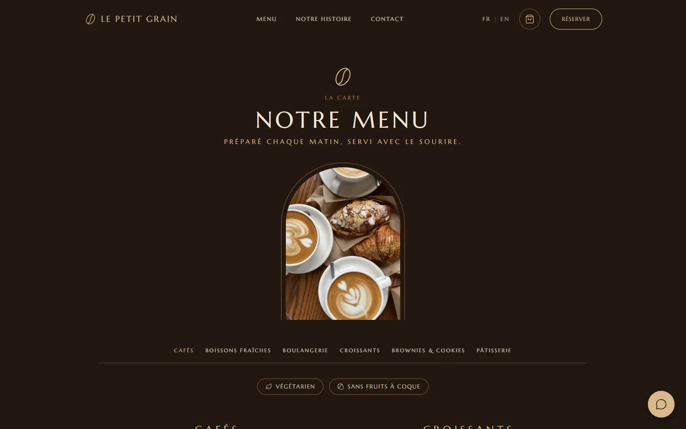
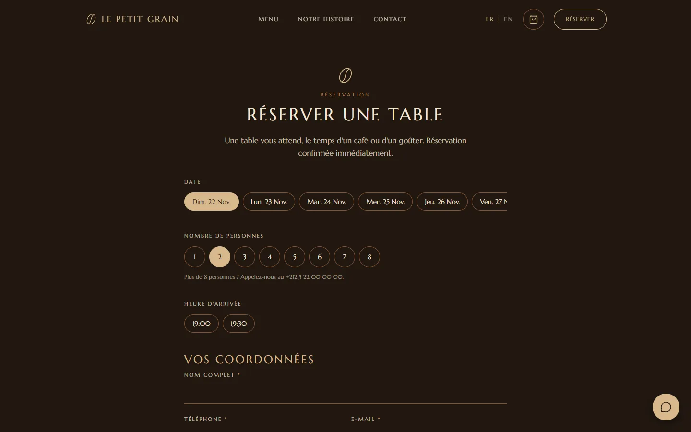
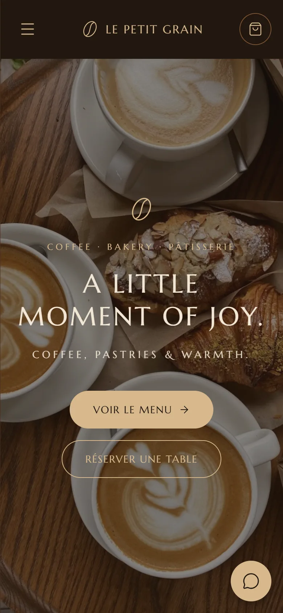
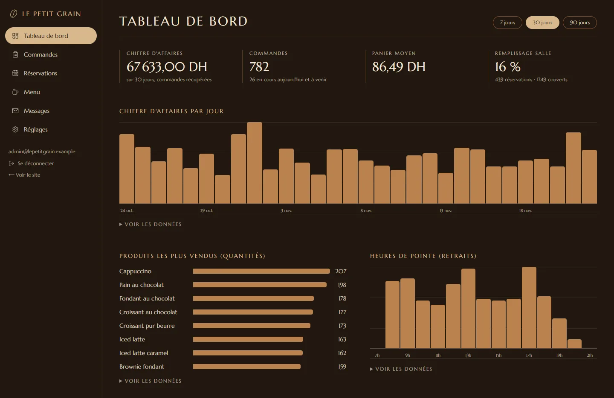
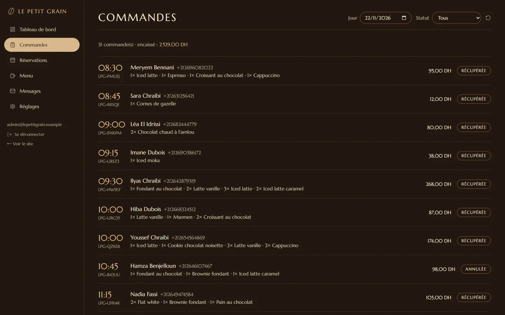

# Le Petit Grain ☕🥐

> **A little moment of joy.** — Site full stack d'un coffee shop et boulangerie artisanale à Casablanca.
> *Marque fictive, projet portfolio.*

Le Petit Grain est une application web complète : site vitrine bilingue (FR/EN), menu connecté
à une base de données, **commande à emporter** avec choix du créneau de retrait, **réservation de
table sans surréservation**, et **espace d'administration** avec tableau de bord des ventes.

**Site en ligne : https://le-petit-grain-nvgc.vercel.app**

---

## Aperçu



| Menu | Fiche produit |
|---|---|
|  |  |

| Réservation de table | Accueil sur téléphone |
|---|---|
|  |  |

**Espace admin** : tableau de bord des ventes et commandes du jour.





---

## Fonctionnalités

### Site public (français / anglais)
- **Accueil** : hero plein écran, engagements, best-sellers, catégories, vitrine animée des boissons, galerie.
- **Menu** connecté à l'API : 6 catégories, barre de catégories collante qui suit le défilement,
  filtres *végétarien* et *sans fruits à coque*, badges best-seller, produits épuisés signalés.
- **Fiche produit** : photo, description, informations alimentaires, choix de la quantité.
- **Panier** conservé dans le navigateur, **commande à emporter** avec choix du jour et du créneau
  de retrait, **paiement sur place**, page de confirmation avec numéro de commande et suivi du statut.
- **Réservation de table** : date, nombre de personnes, créneau ; **lien unique** pour modifier ou annuler.
- Pages **Notre histoire**, **Contact** (horaires, formulaire), pages légales, page 404, page d'erreur.
- Langue du navigateur détectée automatiquement, bouton FR | EN, prix « 25,00 DH » / « 25.00 MAD ».

### Espace admin (`/fr/admin`)
- Connexion sécurisée (session dans un cookie httpOnly).
- **Tableau de bord** : chiffre d'affaires par jour, produits les plus vendus, heures de pointe,
  panier moyen, taux de remplissage de la salle (périodes 7 / 30 / 90 jours).
- **Commandes** du jour, changement de statut (*En attente → Confirmée → En préparation → Prête → Récupérée*, ou *Annulée*).
- **Réservations** par jour, annulation, nombre de couverts.
- **Menu** : création / modification des produits (FR et EN), prix, disponibilité, best-seller, catégories visibles.
- **Réglages** : capacité de la salle, durée des créneaux, horaires d'ouverture.
- **Messages** du formulaire de contact.

---

## Stack technique

| Partie | Technologies |
|---|---|
| Frontend | Next.js 16 (App Router, Cache Components) · React 19 · TypeScript · Tailwind CSS 4 · next-intl · Motion |
| Backend | FastAPI · Pydantic 2 · SQLAlchemy 2 · Alembic |
| Base de données | PostgreSQL 17 (Docker en local) |
| Tests | pytest (72 tests backend) · Vitest (53 tests frontend) |

### Points d'architecture
- **Les prix sont toujours recalculés par le backend** : le navigateur n'envoie que des slugs et des quantités.
- **Aucune surréservation**, même avec deux demandes simultanées : contrôle de capacité sous verrou
  PostgreSQL (`SELECT … FOR UPDATE`), vérifié par un test multi-threads.
- **Dates stockées en UTC**, affichées et calculées en heure de Casablanca (`Africa/Casablanca`).
- **Relais `/api`** : Next.js transmet `/api/*` au backend ; le navigateur ne voit qu'un domaine,
  ce qui rend le cookie admin fiable (pas de cookie tiers).
- **Mots de passe hachés (argon2)**, jetons de session et liens de réservation stockés sous forme d'empreinte SHA-256.
- **Erreurs claires dans les deux langues** : `{ "code": "SLOT_FULL", "message": "…" }`.
- Limitation des tentatives sur la connexion admin et les formulaires, CORS limité au frontend.
- Pages du menu **pré-rendues et mises en cache**, vidées à la demande quand l'admin modifie un produit.

Détails : [docs/ARCHITECTURE.md](docs/ARCHITECTURE.md).

---

## Lancer le projet en local

### Prérequis
Node.js 20+, Python 3.12+, Docker Desktop.

### 1. Base de données
```bash
docker compose up -d          # PostgreSQL 17 (bases de dev et de test)
```

### 2. Backend
```bash
cd backend
python -m venv .venv
.venv\Scripts\activate         # Windows  (macOS/Linux : source .venv/bin/activate)
pip install -r requirements.txt
cp .env.example .env
alembic upgrade head           # crée les tables
python -m scripts.seed_menu    # 6 catégories, 25 produits
python -m scripts.seed_demo    # ~3 mois de commandes et réservations fictives
python -m scripts.create_admin admin@lepetitgrain.example   # crée le compte admin
uvicorn app.main:app --reload  # http://localhost:8000/docs
```

### 3. Frontend
```bash
cd frontend
npm install
cp .env.example .env.local
npm run dev                    # http://localhost:3000
```

### Tests
```bash
cd backend  && pytest          # 72 tests (base de test séparée)
cd frontend && npm test        # 53 tests
```

---

## Mise en ligne

| Service | Rôle |
|---|---|
| **Vercel** (projet 1, dossier `frontend/`) | le site Next.js ; variable `API_URL` = adresse du backend |
| **Vercel** (projet 2, dossier `backend/`) | l'API FastAPI en fonction Python (point d'entrée [`backend/index.py`](backend/index.py)) ; variables `DATABASE_URL`, `ENVIRONMENT=production`, `FRONTEND_ORIGIN` |
| **Neon** | PostgreSQL gratuit et persistant |

Chaque `git push` sur `main` redéploie automatiquement les deux projets.
Le site appelle l'API par son propre domaine (relais `/api`), le cookie admin reste donc « first-party ».

Alternative : [`render.yaml`](render.yaml) décrit le même backend pour Render (migrations au déploiement).

### Base Neon
Le projet est lié à Neon (`neon.ts`, branche `production`). `neon deploy` écrit les adresses dans
`.env.local` à la racine (non commité) :
- `DATABASE_URL` (pooled, « -pooler ») pour l'application : les *prepared statements* de psycopg
  sont alors désactivés, car le pooler PgBouncer de Neon fonctionne en mode transaction ;
- `DATABASE_URL_UNPOOLED` (connexion directe) pour les migrations Alembic.

Pour utiliser Neon en local à la place de Docker :
```powershell
cd backend
powershell -ExecutionPolicy Bypass -File scripts\neon.ps1 -Setup   # 1re fois : tables, menu, démo, admin
powershell -ExecutionPolicy Bypass -File scripts\neon.ps1          # ensuite : l'API seule
```
Sur Render, renseigner les mêmes `DATABASE_URL` et `DATABASE_URL_UNPOOLED`.

---

## Crédits

- **Le Petit Grain est une marque fictive** créée pour un projet portfolio : aucune vente réelle,
  adresse, téléphone et e-mail fictifs.
- Les visuels sont utilisés **à titre d'illustration** (en partie générés par IA). Avant toute
  publication publique, ils doivent être remplacés par des images libres de droits ou générées pour le projet.
- Police : Marcellus (Google Fonts). Icônes : Lucide.
